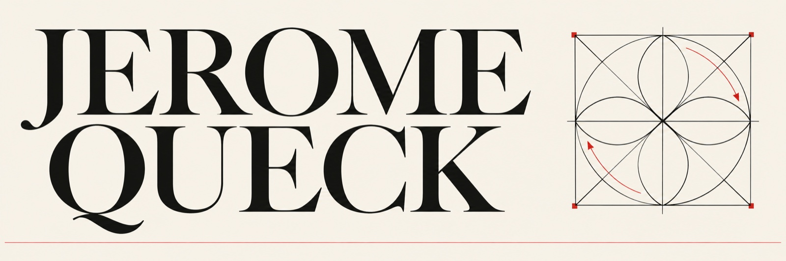
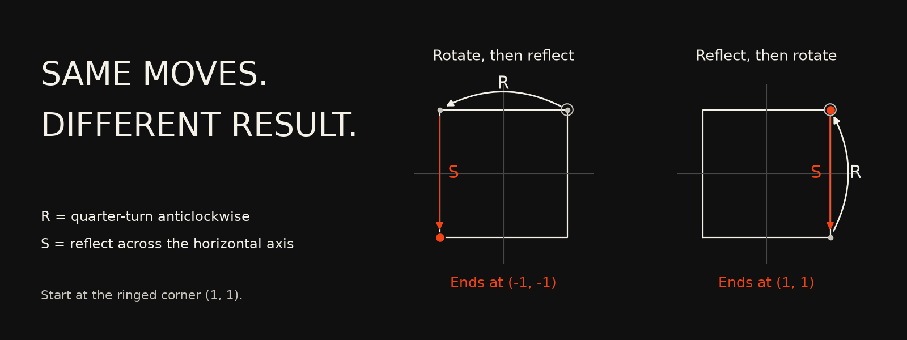

# Mathematics & software

I study mathematics and build tools for learning, research and organising my work.

[Mathematics](#mathematics) · [Software](#software) · [Upstream work](#upstream-work) · [Activity](#public-work)

[Website](https://jeromegroup.org) · [LinkedIn](https://www.linkedin.com/in/jeromequeck/) · [Jerome-Group](https://github.com/Jerome-Group)

<a href="https://github.com/jerome-queck/jerome-queck/tree/prototype/personal-editorial/_preview">
<picture>
  <source media="(max-width: 600px)" srcset="https://raw.githubusercontent.com/jerome-queck/jerome-queck/prototype/personal-editorial/_preview/counters-mobile.svg">
  
</picture>
</a>

Public authored work, across public repositories. [Definitions and last successful refresh](https://github.com/jerome-queck/jerome-queck/tree/prototype/personal-editorial/_preview). These counts measure records and linked resolutions, not effort.

## 01 · Mathematics

Notes and tools that make an idea easier to explore.

<a href="https://algebra.jeromegroup.org">
<picture>
  <source media="(max-width: 600px)" srcset="assets/order-matters-mobile.png">
  
</picture>
</a>

A small example of a bigger idea. Rotate a square, then reflect it. Reverse those moves and the marked corner lands somewhere else. [Explore groups and actions in Algebra](https://algebra.jeromegroup.org).

<table>
<tr>
<td width="50%" valign="top">
<h3><a href="https://algebra.jeromegroup.org">Algebra ↗</a></h3>

Structure and symmetry.

Groups, rings, fields and representations, with visual laboratories and proof writing.

<a href="https://github.com/Jerome-Group/algebra">Source</a>
</td>
<td width="50%" valign="top">
<h3><a href="https://calculus.jeromegroup.org">Calculus ↗</a></h3>

Change and geometry.

One-variable and multivariable calculus through arguments, examples and interactive geometry.

<a href="https://github.com/Jerome-Group/calculus">Source</a>
</td>
</tr>
<tr>
<td width="50%" valign="top">
<h3><a href="https://probability.jeromegroup.org">Probability ↗</a></h3>

Reasoning about uncertainty.

A first course with worked examples, practice and experiments.

<a href="https://github.com/jerome-queck/probability">Source</a>
</td>
<td width="50%" valign="top">
<h3><a href="https://numbertheory.jeromegroup.org">Number theory ↗</a></h3>

Patterns in the integers.

Proofs, practice and exact computational experiments in elementary number theory.

<a href="https://github.com/Jerome-Group/numbertheory">Source</a>
</td>
</tr>
</table>

### Work it out

**[Open Calculator ↗](https://calculator.jeromegroup.org)** for mathematical notebooks with exact computation, graphs and reusable definitions. Sign-in required. [Source](https://github.com/Jerome-Group/calculator).

## 02 · Software

Systems I use for my own degree and research.

### Course material, made local

[NTULearn Sync](https://github.com/Jerome-Group/ntulearn) turns course pages and announcements into Markdown and saves attachments in their original formats. It writes those sources into local module folders.

[Academic OS](https://github.com/Jerome-Group/academic-os) works with those folders, alongside tasks and calendars. It checks source structure, freshness and missing material. Having a file is not evidence of learning it.

### Two assistants, different jobs

<table>
<tr>
<td width="50%" valign="top">
<h3><a href="https://github.com/Jerome-Group/syrax">Syrax ↗</a></h3>

My Telegram assistant, built on OpenClaw.

Its academic desk can query NTULearn Sync and Academic OS, alongside file search and other tools.

</td>
<td width="50%" valign="top">
<h3><a href="https://github.com/jerome-queck/emmy">Emmy ↗</a></h3>

My operating kit for ChatGPT Dot.

Responsibility context and current evidence checks. Native products own execution, permissions, schedules and delivery.

</td>
</tr>
</table>

## 03 · Upstream work

Selected fixes, with the actual pull requests.

### OpenClaw · runtime failure

Oversized Groq requests were repeatedly retried as recoverable rate limits, leaving sessions stuck. The fix stops futile retries, returns clear `/reset` or `/new` guidance, and preserves configured fallback.

[PR #130275](https://github.com/openclaw/openclaw/pull/130275) · **Merged 28 August 2026**.

### freeCodeCamp · callback definitions

The callback review definitions excluded synchronous callbacks. The correction makes the definition cover both synchronous and asynchronous use.

[PR #71474](https://github.com/freeCodeCamp/freeCodeCamp/pull/71474) · **Merged 31 October 2026**.

## Public work

[Daily refresh workflow](https://github.com/jerome-queck/jerome-queck/actions/workflows/profile.yml) · [Current numbers and records](https://github.com/jerome-queck/jerome-queck/tree/prototype/personal-editorial/_preview).

Calendar, two recent events and metric definitions

Counters cover all-time public PRs authored by me. Linked resolutions count distinct currently closed public issues linked to those merged PRs, closed at or after the merge. This does not measure who clicked Close or establish that a PR alone caused the resolution.

The calendar and aggregate counts span all public projects. The recent feed samples the latest 300 public GitHub events. Failed refreshes retain the previous published data and timestamp. GitHub can delay scheduled runs.

