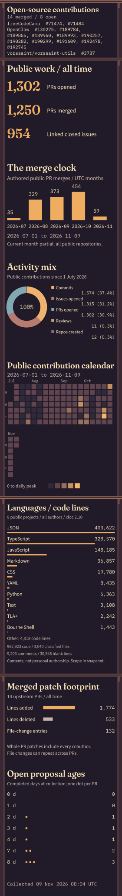

<picture><source media="(prefers-reduced-motion: reduce) and (min-width: 601px)" srcset="assets/pixel-world/full-wide-still.svg#hero"><source media="(prefers-reduced-motion: reduce)" srcset="assets/pixel-world/full-mobile-still.svg#hero"><source media="(min-width: 601px)" srcset="assets/pixel-world/full-wide-ambient.svg#hero"></picture> 
<a href="https://github.com/Jerome-Group/ntulearn"><picture><source media="(prefers-reduced-motion: reduce) and (min-width: 601px)" srcset="assets/pixel-world/full-wide-still.svg#ntulearn"><source media="(prefers-reduced-motion: reduce)" srcset="assets/pixel-world/full-mobile-still.svg#ntulearn"><source media="(min-width: 601px)" srcset="assets/pixel-world/full-wide-ambient.svg#ntulearn"></picture></a> 
<a href="https://github.com/Jerome-Group/academic-os"><picture><source media="(prefers-reduced-motion: reduce) and (min-width: 601px)" srcset="assets/pixel-world/full-wide-still.svg#academic-os"><source media="(prefers-reduced-motion: reduce)" srcset="assets/pixel-world/full-mobile-still.svg#academic-os"><source media="(min-width: 601px)" srcset="assets/pixel-world/full-wide-ambient.svg#academic-os"></picture></a> 
<a href="https://github.com/Jerome-Group/syrax"><picture><source media="(prefers-reduced-motion: reduce) and (min-width: 601px)" srcset="assets/pixel-world/full-wide-still.svg#syrax"><source media="(prefers-reduced-motion: reduce)" srcset="assets/pixel-world/full-mobile-still.svg#syrax"><source media="(min-width: 601px)" srcset="assets/pixel-world/full-wide-ambient.svg#syrax"></picture></a> 
<a href="https://github.com/jerome-queck/emmy"><picture><source media="(prefers-reduced-motion: reduce) and (min-width: 601px)" srcset="assets/pixel-world/full-wide-still.svg#emmy"><source media="(prefers-reduced-motion: reduce)" srcset="assets/pixel-world/full-mobile-still.svg#emmy"><source media="(min-width: 601px)" srcset="assets/pixel-world/full-wide-ambient.svg#emmy"></picture></a> 
<a href="https://algebra.jeromegroup.org"><picture><source media="(prefers-reduced-motion: reduce) and (min-width: 601px)" srcset="assets/pixel-world/title-wide-still.svg#algebra"><source media="(prefers-reduced-motion: reduce)" srcset="assets/pixel-world/title-mobile-still.svg#algebra"><source media="(min-width: 601px)" srcset="assets/pixel-world/title-wide-ambient.svg#algebra"></picture></a><a href="https://github.com/Jerome-Group/algebra"><picture><source media="(prefers-reduced-motion: reduce) and (min-width: 601px)" srcset="assets/pixel-world/source-wide-still.svg#algebra"><source media="(prefers-reduced-motion: reduce)" srcset="assets/pixel-world/source-mobile-still.svg#algebra"><source media="(min-width: 601px)" srcset="assets/pixel-world/source-wide-ambient.svg#algebra"></picture></a> 
<a href="https://calculus.jeromegroup.org"><picture><source media="(prefers-reduced-motion: reduce) and (min-width: 601px)" srcset="assets/pixel-world/title-wide-still.svg#calculus"><source media="(prefers-reduced-motion: reduce)" srcset="assets/pixel-world/title-mobile-still.svg#calculus"><source media="(min-width: 601px)" srcset="assets/pixel-world/title-wide-ambient.svg#calculus"></picture></a><a href="https://github.com/Jerome-Group/calculus"><picture><source media="(prefers-reduced-motion: reduce) and (min-width: 601px)" srcset="assets/pixel-world/source-wide-still.svg#calculus"><source media="(prefers-reduced-motion: reduce)" srcset="assets/pixel-world/source-mobile-still.svg#calculus"><source media="(min-width: 601px)" srcset="assets/pixel-world/source-wide-ambient.svg#calculus"></picture></a> 
<a href="https://probability.jeromegroup.org"><picture><source media="(prefers-reduced-motion: reduce) and (min-width: 601px)" srcset="assets/pixel-world/title-wide-still.svg#probability"><source media="(prefers-reduced-motion: reduce)" srcset="assets/pixel-world/title-mobile-still.svg#probability"><source media="(min-width: 601px)" srcset="assets/pixel-world/title-wide-ambient.svg#probability"></picture></a><a href="https://github.com/jerome-queck/probability"><picture><source media="(prefers-reduced-motion: reduce) and (min-width: 601px)" srcset="assets/pixel-world/source-wide-still.svg#probability"><source media="(prefers-reduced-motion: reduce)" srcset="assets/pixel-world/source-mobile-still.svg#probability"><source media="(min-width: 601px)" srcset="assets/pixel-world/source-wide-ambient.svg#probability"></picture></a> 
<a href="https://numbertheory.jeromegroup.org"><picture><source media="(prefers-reduced-motion: reduce) and (min-width: 601px)" srcset="assets/pixel-world/title-wide-still.svg#numbertheory"><source media="(prefers-reduced-motion: reduce)" srcset="assets/pixel-world/title-mobile-still.svg#numbertheory"><source media="(min-width: 601px)" srcset="assets/pixel-world/title-wide-ambient.svg#numbertheory"></picture></a><a href="https://github.com/Jerome-Group/numbertheory"><picture><source media="(prefers-reduced-motion: reduce) and (min-width: 601px)" srcset="assets/pixel-world/source-wide-still.svg#numbertheory"><source media="(prefers-reduced-motion: reduce)" srcset="assets/pixel-world/source-mobile-still.svg#numbertheory"><source media="(min-width: 601px)" srcset="assets/pixel-world/source-wide-ambient.svg#numbertheory"></picture></a> 
<a href="https://calculator.jeromegroup.org"><picture><source media="(prefers-reduced-motion: reduce) and (min-width: 601px)" srcset="assets/pixel-world/title-wide-still.svg#calculator"><source media="(prefers-reduced-motion: reduce)" srcset="assets/pixel-world/title-mobile-still.svg#calculator"><source media="(min-width: 601px)" srcset="assets/pixel-world/title-wide-ambient.svg#calculator"></picture></a><a href="https://github.com/Jerome-Group/calculator"><picture><source media="(prefers-reduced-motion: reduce) and (min-width: 601px)" srcset="assets/pixel-world/source-wide-still.svg#calculator"><source media="(prefers-reduced-motion: reduce)" srcset="assets/pixel-world/source-mobile-still.svg#calculator"><source media="(min-width: 601px)" srcset="assets/pixel-world/source-wide-ambient.svg#calculator"></picture></a> 
<picture><source media="(prefers-reduced-motion: reduce) and (min-width: 601px)" srcset="https://raw.githubusercontent.com/jerome-queck/jerome-queck/profile-data/world-still.svg"><source media="(prefers-reduced-motion: reduce)" srcset="https://raw.githubusercontent.com/jerome-queck/jerome-queck/profile-data/world-mobile-still.svg"><source media="(min-width: 601px)" srcset="https://raw.githubusercontent.com/jerome-queck/jerome-queck/profile-data/world.svg"></picture>

Text edition, links and sources

## Things I make

- **[NTULearn Sync](https://github.com/Jerome-Group/ntulearn)** — Course pages and attachments, gathered for study.
- **[Academic OS](https://github.com/Jerome-Group/academic-os)** — A study desk for sources, tasks and freshness.
- **[Syrax](https://github.com/Jerome-Group/syrax)** — A Telegram assistant with an academic desk.
- **[Emmy](https://github.com/jerome-queck/emmy)** — An operating kit for ChatGPT Dot.
- **[Algebra](https://algebra.jeromegroup.org)** — Structure, symmetry and proofs. [Repository](https://github.com/Jerome-Group/algebra).
- **[Calculus](https://calculus.jeromegroup.org)** — Change, geometry and arguments. [Repository](https://github.com/Jerome-Group/calculus).
- **[Probability](https://probability.jeromegroup.org)** — Uncertainty, examples and experiments. [Repository](https://github.com/jerome-queck/probability).
- **[Number theory](https://numbertheory.jeromegroup.org)** — Proofs and exact computational experiments. [Repository](https://github.com/Jerome-Group/numbertheory).
- **[Calculator](https://calculator.jeromegroup.org)** — Exact computation and notebooks. Sign-in required. [Repository](https://github.com/Jerome-Group/calculator).

## Open-source contributions

- OpenClaw structured-file tooling: [#189784](https://github.com/openclaw/openclaw/pull/189784) adds cycle-safe YAML alias traversal; [#189855](https://github.com/openclaw/openclaw/pull/189855) edits the effective duplicate JSON key; [#189960](https://github.com/openclaw/openclaw/pull/189960) gives recursive JSONL searches reusable line addresses.
- OpenClaw [#189993](https://github.com/openclaw/openclaw/pull/189993) makes invalid CLI input errors actionable; [#130275](https://github.com/openclaw/openclaw/pull/130275) stops futile oversized Groq retries while preserving fallback.
- freeCodeCamp [#71474](https://github.com/freeCodeCamp/freeCodeCamp/pull/71474) corrects synchronous and asynchronous callback definitions.

**Open proposals observed 2 November 2026:** [freeCodeCamp #71484](https://github.com/freeCodeCamp/freeCodeCamp/pull/71484) and [#71496](https://github.com/freeCodeCamp/freeCodeCamp/pull/71496), and [OpenClaw #190799](https://github.com/openclaw/openclaw/pull/190799). These were open at that observation.

[All public records and definitions](https://github.com/jerome-queck/jerome-queck/tree/profile-data) · [Website](https://jeromegroup.org) · [LinkedIn](https://www.linkedin.com/in/jeromequeck/) · [Jerome-Group](https://github.com/Jerome-Group)

Counters are all time. Both time graphs begin 1 July 2026; the current month is partial. Public records measure frequency, not effort or quality. Linked closed issues do not establish who closed them. GitHub language bytes describe repository contents, not expertise. A failed refresh retains the last complete snapshot and its timestamp.

[Artwork, type and data](docs/design/midnight-workshop.md)

