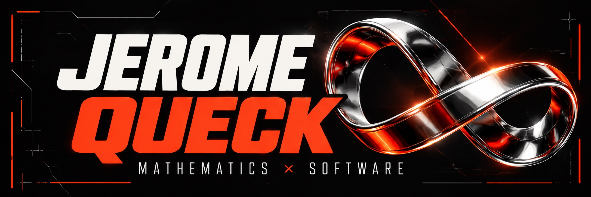
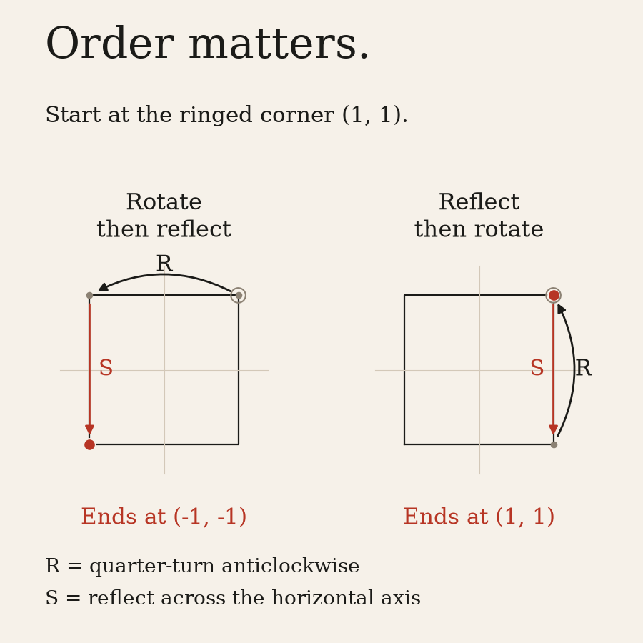
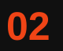
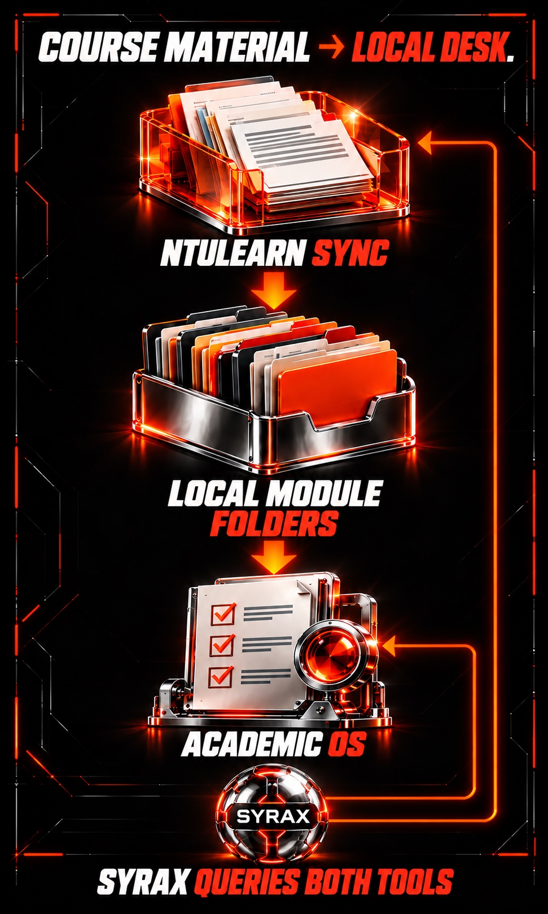

# Mathematics & software

I study mathematics and build tools for learning, research and organising my work.

[Website](https://jeromegroup.org) · [LinkedIn](https://www.linkedin.com/in/jeromequeck/) · [Jerome-Group](https://github.com/Jerome-Group)

##  Mathematics

Notes websites and tools for exploring ideas. A small example from algebra follows. **The order of two operations can change their result.**

<a href="https://algebra.jeromegroup.org">
<picture>
  <source media="(min-width: 601px)" srcset="assets/order-matters.png">
  
</picture>
</a>

**Algebra** explores structure and symmetry; **Calculus** explores change and geometry. **Probability** develops reasoning about uncertainty; **Number theory** explores patterns in the integers.

**Calculator** provides mathematical notebooks with exact computation, graphs and reusable definitions. **Sign-in required.**

Five mathematics destinations, descriptions and source

- **[Algebra](https://algebra.jeromegroup.org)**. Groups, rings, fields and representations, with visual laboratories and proof writing. [Source](https://github.com/Jerome-Group/algebra).
- **[Calculus](https://calculus.jeromegroup.org)**. One-variable and multivariable calculus through arguments, examples and interactive geometry. [Source](https://github.com/Jerome-Group/calculus).
- **[Probability](https://probability.jeromegroup.org)**. A first course with worked examples, practice and experiments. [Source](https://github.com/jerome-queck/probability).
- **[Number theory](https://numbertheory.jeromegroup.org)**. Proofs, practice and exact computational experiments in elementary number theory. [Source](https://github.com/Jerome-Group/numbertheory).
- **[Calculator](https://calculator.jeromegroup.org)**. Mathematical notebooks with exact computation, graphs and reusable definitions. Sign-in required. [Source](https://github.com/Jerome-Group/calculator).

##  Software

**Course material becomes a local working desk.** These connections describe actual interfaces between the projects.

<picture>
  <source media="(min-width: 601px)" srcset="assets/software-circuit.jpg">
  
</picture>

**[NTULearn Sync](https://github.com/Jerome-Group/ntulearn)** saves pages and announcements as Markdown and attachments in their original formats. **[Academic OS](https://github.com/Jerome-Group/academic-os)** works with those module folders, tasks and calendars, checking source structure, freshness and missing material.

**[Syrax](https://github.com/Jerome-Group/syrax)** is my Telegram assistant, built on OpenClaw, with file search and an academic desk that can query NTULearn Sync and Academic OS.

**[Emmy](https://github.com/jerome-queck/emmy)** provides responsibility context and current evidence checks for ChatGPT Dot. Native products own execution, permissions, schedules and delivery.

##  Public work

<a href="https://github.com/jerome-queck/jerome-queck/tree/profile-data">
<picture>
  <source media="(min-width: 601px)" srcset="https://raw.githubusercontent.com/jerome-queck/jerome-queck/profile-data/counters.svg">
  
</picture>
</a>

<a href="https://github.com/jerome-queck/jerome-queck/tree/profile-data#merge-cadence">
<picture>
  <source media="(min-width: 601px)" srcset="https://raw.githubusercontent.com/jerome-queck/jerome-queck/profile-data/cadence.svg">
  
</picture>
</a>

<a href="https://github.com/jerome-queck/jerome-queck/tree/profile-data#public-contribution-calendar">
<picture>
  <source media="(min-width: 601px)" srcset="https://raw.githubusercontent.com/jerome-queck/jerome-queck/profile-data/calendar.svg">
  
</picture>
</a>

### Selected upstream fixes

**[OpenClaw #130275](https://github.com/openclaw/openclaw/pull/130275), merged 28 August 2026.** Oversized Groq requests were repeatedly retried as recoverable rate limits, leaving sessions stuck. The fix stops futile retries, returns clear `/reset` or `/new` guidance, and preserves configured fallback.

**[freeCodeCamp #71474](https://github.com/freeCodeCamp/freeCodeCamp/pull/71474), merged 31 October 2026.** The callback review definitions excluded synchronous callbacks. The correction covers both synchronous and asynchronous use.

### The repositories behind the work

The nine selected projects, refreshed from their public repositories. Default-branch commit dates cover **any author**. Releases mean published GitHub Releases, including labelled prereleases. Neither establishes deployment status.

Inspect all nine repository tips and published-release records

<a href="https://github.com/jerome-queck/jerome-queck/tree/profile-data#selected-repository-pulse">
<picture>
  <source media="(min-width: 601px)" srcset="https://raw.githubusercontent.com/jerome-queck/jerome-queck/profile-data/pulse.svg">
  
</picture>
</a>

[Last successful collection, definitions and exact values](https://github.com/jerome-queck/jerome-queck/tree/profile-data) · [Daily refresh workflow](https://github.com/jerome-queck/jerome-queck/actions/workflows/profile.yml).

Two recent events and how to read the numbers

Counters cover all-time public PRs authored by me. Linked resolutions count distinct currently closed public issues linked to those merged PRs, closed at or after the merge. This does not measure who clicked Close or prove a PR alone caused closure. Records can change retrospectively.

Merge cadence, calendar and aggregate counts span all public projects. The repository pulse covers only the nine authored selections above. The feed samples the latest 300 public GitHub events, subject to GitHub's 30-day retention. These numbers measure records, not effort, learning or quality.

Every source must succeed before a new publication. Failed refreshes retain the previous snapshot and timestamp. GitHub can delay scheduled runs. Collection spans a recorded interval; GitHub queries are not a transaction at one instant. Published images and accessible text derive from the same saved public input; CDN caches can refresh at different times.

**[Explore the website ↗](https://jeromegroup.org)** · [LinkedIn](https://www.linkedin.com/in/jeromequeck/) · [How this profile is made](docs/design/circuit-atlas.md)
