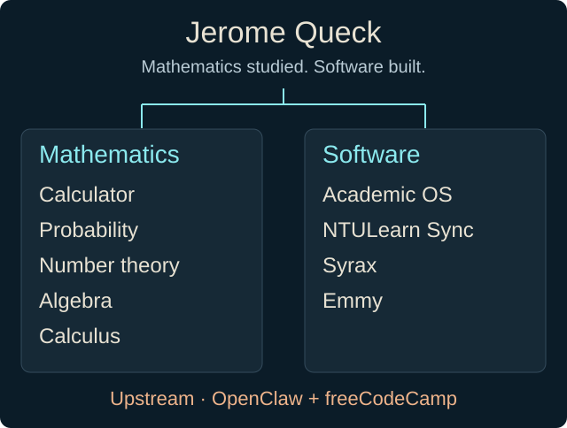

# Jerome Queck

I study mathematics and build software for learning, research and organising my work.

[Website](https://jeromegroup.org) · [LinkedIn](https://www.linkedin.com/in/jeromequeck/) · [Jerome-Group](https://github.com/Jerome-Group)

## Contributions

All-time public PRs authored by me. Linked resolutions count distinct currently closed public issues linked to my merged PRs, closed at or after the merge. They do not measure who clicked Close.

[Numbers, links and last successful refresh](https://github.com/jerome-queck/jerome-queck/tree/prototype/profile-refresh-20261031/prototype-data) · [Daily refresh workflow](https://github.com/jerome-queck/jerome-queck/actions/workflows/profile.yml).
Failed refreshes retain the previous data and timestamp. GitHub can delay scheduled runs.

Public contribution calendar and two recent events

The recent feed samples the latest 300 public GitHub events. The calendar and aggregate counts span all public projects.

## Mathematics

Notes, visual explanations and tools I use to explore the subject.

- [Calculator](https://calculator.jeromegroup.org). Symbolic computation, notebooks and plots. The site requires sign-in. [Source](https://github.com/Jerome-Group/calculator).
- [Probability](https://probability.jeromegroup.org). A first course in probability, published as mathematical notes. [Source](https://github.com/jerome-queck/probability).
- [Number theory](https://numbertheory.jeromegroup.org). An interactive atlas of elementary number theory. [Source](https://github.com/Jerome-Group/numbertheory).
- [Algebra](https://algebra.jeromegroup.org). Groups, rings, fields and representations, with visual explanations and interactive explorations. [Source](https://github.com/Jerome-Group/algebra).
- [Calculus](https://calculus.jeromegroup.org). Limits and derivatives through multivariable and vector calculus, with interactive graphs and geometry. [Source](https://github.com/Jerome-Group/calculus).

## Software

- [Academic OS](https://github.com/Jerome-Group/academic-os). Module and research folders, tasks, calendars and the information behind my academic dashboard.
- [NTULearn Sync](https://github.com/Jerome-Group/ntulearn). Local NTULearn course copies, with Markdown pages, announcements and attachments in their course folders.
- [Syrax](https://github.com/Jerome-Group/syrax). My personal Telegram assistant, built on OpenClaw. Its repository holds setup, configuration and a runtime adapter.
- [Emmy](https://github.com/jerome-queck/emmy). My chief-of-staff operating kit for ChatGPT Dot. Local context, evidence checks and advisory routing, with execution and permissions owned by the native products.

## Upstream contributions

[freeCodeCamp #71474](https://github.com/freeCodeCamp/freeCodeCamp/pull/71474), merged 31 October 2026. Corrected callback review definitions to account for synchronous callbacks.

[OpenClaw #130275](https://github.com/openclaw/openclaw/pull/130275), merged 28 August 2026. Fixed oversized Groq requests being repeatedly retried as rate limits, which left sessions stuck.

OpenClaw repository context

