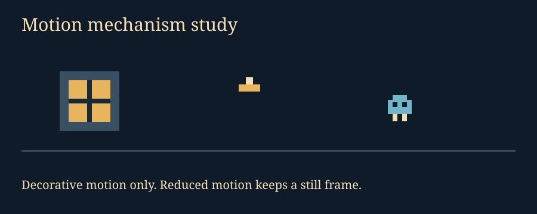
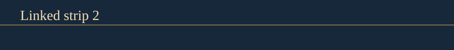

# Technical animation probe

Unapproved artwork. This branch tests GitHub image animation, reduced motion and opaque full-width rendering. It is not a proposed profile design.

<picture>
<source media="(prefers-reduced-motion: reduce)" srcset="assets/motion-proof-still.svg">

</picture>

[Project issue](https://github.com/jerome-queck/jerome-queck/issues/14).

## Continuous linked canvas probe

  

## Native view fragment proof

 

## Embedded scene view proof

 

