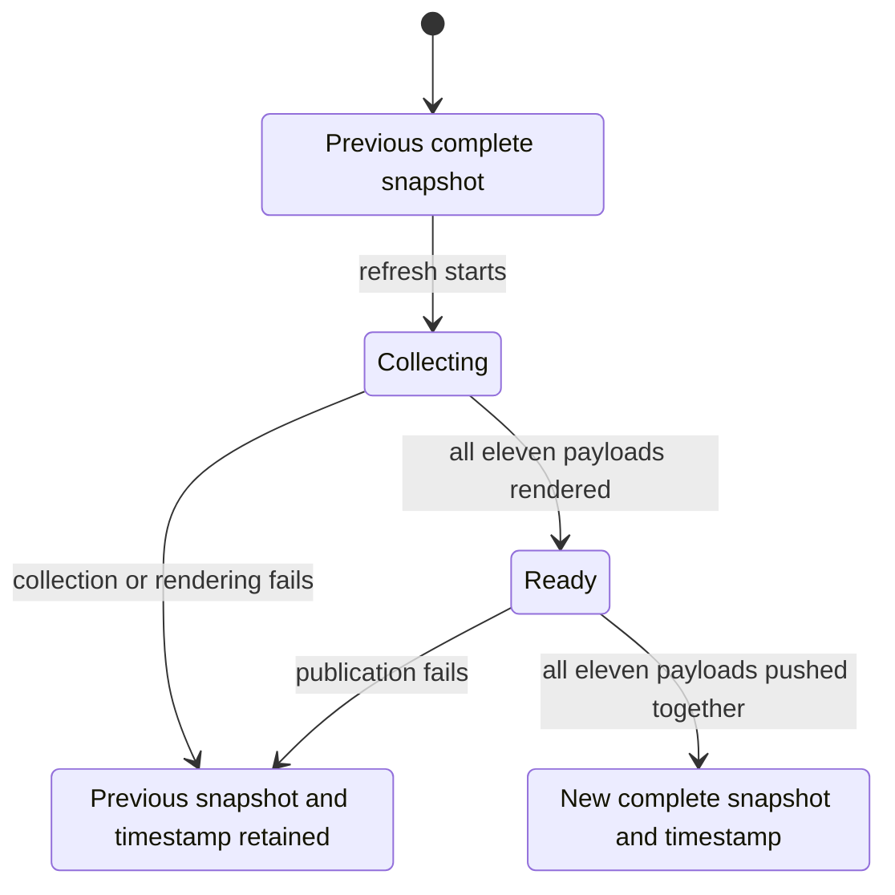

# One personal-profile refresh

The statechart skill checked a bounded TLA+ model of the current eleven-payload personal publication lifecycle. It assumes a complete previous snapshot, one publisher, one attempt, two abstract generations and an atomic Git ref update.

The actual wrapper/TLC run reached five states and seven steps. Complete publication, failure retention, unchanged authored main and no artificial deadlock held in that finite model. Terminal self steps are omitted from the chart.

A deliberate mutation published only the new README and abstract timestamp, leaving ten payloads old. It reached six states and nine steps and broke complete publication on the shortest path, numbered 0 previous snapshot, 1 collection begins, 2 all outputs ready, 3 partial publication. This exposes why generation success alone is insufficient.

The source workflow explicitly copies and stages every required payload. Local shell/Git fixture tests omit each of eleven files and verify the remote ref stays unchanged; the complete case advances in one commit and preserves unrelated files. A separate deliberate local mutant removed ten copy operations and staged README only, reproducing mixed generations against a temporary bare remote. This is a mutation control, not an actual-source defect or hosted failure injection.

The model omits API truth, privacy filters, pagination, SVG validity, exact timestamp contents, first publication, migration, concurrency, retries, competing writes, scheduling, liveness and CDN caches. It does not prove the Python or Actions workflow. Query reads span an observation interval, and caches can refresh separately even after a single Git publication.

The full model, configs, view, logs, passing/mutation SVGs and reproduction script are retained outside the repository in the task's `personal-profile-redesign/statechart` evidence directory. The wrapper observed TLC 2.19 with Java 21. Its reused jar filename says 1.7.4; the runtime banner, not that filename, determines the reported version. Run the retained `reproduce.sh` with new output suffixes; the mutant intentionally exits nonzero.
