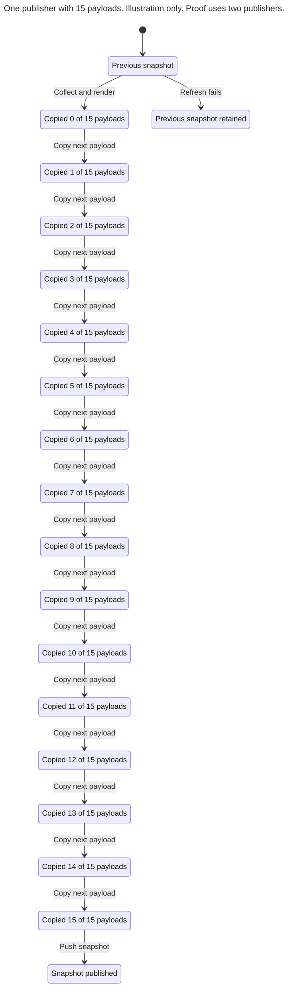

# Profile snapshot publication

The maintained proof checks publication of 15 payloads to an existing `profile-data` ref. A successful push exposes one complete generation. Failure before push retains the remote ref. A stale non-force push cannot overwrite a newer commit.

The authoritative bounded model is [Publication.tla](../../formal/Publication.tla), with two publishers making one attempt each, one complete old generation and two possible fresh generations. TLC explores 1,223 distinct states, 2,377 generated states, depth 35. CompleteSnapshot and StaleRejected hold. Run `python3 formal/check.py` through the [publication skill](../../.agents/skills/profile-publication/SKILL.md). CI invokes that command. Source synchronization is deliberately pending in this prepared maintenance unit, and the command currently rejects stale source hashes; see the maintenance record before refreshing them.

The full passing model exceeds Statechart's 500-state chart budget. This generated chart is only a one-publisher illustration, not the concurrent proof. It reaches 34 states and 34 steps. It hides 16 failure arrows from copying stages; each retains the prior remote snapshot, matching the visible failure outcome.

The real shell/Git fixture removes each of the 15 generated payloads in turn and checks that the remote ref remains unchanged. The complete case advances in one commit and preserves unrelated files. The stale-parent fixture uses a bare Git remote and two divergent checkouts; the later non-force push is rejected without moving the newer remote ref.

The checker deliberately removes the cadence-mobile.svg copy from a scratch workflow. That workflow pushes successfully but publishes the old cadence-mobile bytes alongside new files. The fixture must fail on those wrong bytes, not an execution exception. The model's matching copy-6 mutant breaks CompleteSnapshot on its shortest 17-step path: collect/render, 15 copies with copy 6 skipped, then push. The restored source and model must pass.

The former five-state, eleven-payload chart was a historical design sketch. It abstracted all copying into one publication action and omitted competing publishers. It motivated the complete-generation invariant but does not describe the current proof or payload count. The [maintenance record](../../formal/maintenance.md) records the source drift, mapping updates and retained evidence.

The proof assumes a complete existing snapshot, atomic Git non-force ref updates and no other writer. Within this two-attempt bound, generation equality represents the ancestry test. Hosted workflow concurrency serializes actual runs; hosted execution itself is not exercised. The model excludes first publication, arbitrary writers, retries, liveness, scheduler behavior, API truth, pagination correctness, font layout, renderer internals, animation and CDN cache consistency. Query reads span an observation interval; caches can refresh separately after one Git publication.
