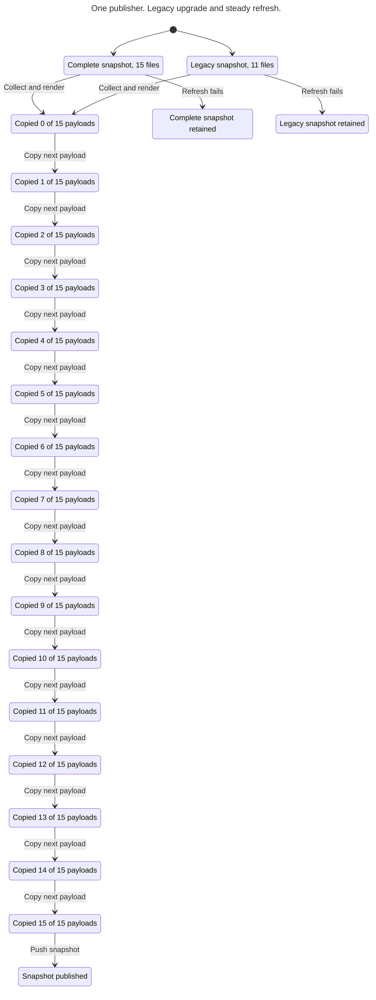

# Publication proof maintenance

The source mapping is synchronized to `a968bf7`. The follow-up to `db91bb7` removes narration and sizes cadence columns from measured labels, allowing the current five-month mobile view to occupy one row. These changes do not move collection, rendering, writing or push boundaries. A layout failure still occurs before the completed mapping is returned. The unchanged checker rejected the changed helper hash before the mapping was refreshed. The prior synchronized base was `92b883461dbd1031a74d0730f40f83c891e6ce8b`; the unchanged check refused the workflow hash before this review. That was verification drift, not a demonstrated product bug. The covered diff includes e064c03's upstream inputs and font rendering, 865a4ed's four world outputs, 503c463's schema-v3 metrics, f22f6b3's source-line collection, 884d95d's calendar changes, and db91bb7's cadence layout. CI invokes the checker since ece575f.

`collect_snapshot` collects each required source, including source lines. `render_snapshot` validates schema 4 and builds the entire 15-file mapping. `main` writes only after both return. A generation failure or partial output write prevents the dependent publish job from receiving a successful artifact. The publish shell checks out the existing ref, copies and stages every payload, removes the obsolete card, and commits and pushes once if changed. An unchanged output is a no-op. The model abstracts collection, rendering, writes, artifact transfer and failed copies as pre-push failure. It treats unchanged successful publication as a complete generation; it does not distinguish the no-op branch. The source mapping covers the workflow, CI, collection and rendering entry points, their imported local helper modules, requirements, project catalogue and both Git fixtures. Their hashes are review alarms, not proof of their semantics. `scripts/render_readme_world.py` authors separate static artwork; the publication workflow does not call it and it is outside this proof.

The model starts from either the 11-file legacy snapshot with four absent world files or a complete 15-file snapshot. Two publishers attempt once each, capture a base, copy the 15 payloads and attempt an atomic non-force update. The numbered copies abstract their order except copy 6, which the guard maps to the actual cadence-mobile copy. Git ancestry is represented by generation equality only within this bound. Hosted workflow concurrency serializes runs; the model explores overlapping attempts. First publication to an absent ref, retries, arbitrary writers, liveness, hosted execution, API truth, font layout, pixel scene quality, randomness, animation and CDN consistency are excluded. Rendering is assumed successful before Ready; fixture execution supplies evidence for shell and Git correspondence, not a proof of their semantics.

TLC 2.19 with pinned TLA+ tools 1.7.4 explores 2,431 distinct states and 4,742 generated states to depth 35. `CompleteSnapshot` and `StaleRejected` hold. Omitting the existing cadence-mobile copy breaks completeness in 17 transitions, including from the legacy state. The scratch workflow reproduces the mixed snapshot with old cadence-mobile content; the restored fixture passes both initial states, all 15 missing payloads, complete one-commit updates, unrelated-file preservation and stale-parent rejection. Omitting a new world file is not modeled as a successful push: staging the absent path fails. Structural guard mutations for the bound, legacy slots, copy, staging and CI invocation were rejected. Detailed run output is retained as external evidence.

[One-publisher lifecycle](chart.mmd) is an illustration of both initial states, not the two-publisher proof. Its view hides 32 copy-stage failure steps; each retains its initial snapshot. The two-publisher passing run exceeds Statechart's 500-state drawing budget. The legacy-only mutant path and full passing report were generated separately.

## One-publisher lifecycle

This is the exact Statechart output from `chart.cfg`. It illustrates the checked lifecycle for one publisher, with both starting snapshots. The full two-publisher proof is reported above. Thirty-two copy-stage failure transitions are hidden; each leaves its initial complete or legacy snapshot intact.

